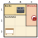
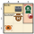
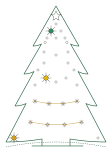

<!-- ERZEUGT von spiele/eingeschneit/werkzeug/baue_seite.py im Repo pytree – nicht von Hand ändern, dort ändern und neu bauen. -->
# Eingeschneit auf der Hohen Wand

*Ein Rätsel-Adventskalender.*

Am ersten Dezember fährt eine Familie auf die Hohe Wand, und es schneit, bis die Straße zu ist.
Vierundzwanzig Tage bleiben sie oben, mit sechs anderen, die mit ihnen eingeschneit sind, und machen aus dem
Notquartier ein Weihnachtsfest. Jeden Tag fehlt etwas, und jeden Tag ist die Frage dieselbe: Wer hat es?

Jeder Tag ist eine Doppelseite. Links steht die Geschichte, unten die Frage und das Feld für den Code. Rechts ist der
Plan des Orts, daneben stehen die Personen von heute, die Aussagen und Platz für Notizen. Gelöst wird mit Bleistift
im Heft, geprüft am Baum. Ein Tag braucht 10 bis 20 min, der 6., 12., 18. und 24. etwas länger: An diesen Tagen
verweisen Aussagen auf frühere Tage, und dann hilft dir, was du damals in den Plan geschrieben hast.

Ganz hinten stehen für jeden Tag Tipp 1, Tipp 2 und die Lösung, in dieser Reihenfolge, danach „Technik und
Bedienung“.

**Vor dir liegt das Heft, und es hat dich hierher geschickt? Dann bist du hier richtig.**

## So geht's

Die Felder heißen wie Planquadrate: die Spalte als Buchstabe von links, A bis G, die Zeile als Zahl von oben, 1 bis 7.
C5 ist also die dritte Spalte und die fünfte Zeile.

1. Der Plan zeigt einen Ort dort oben, von oben gesehen. Jeder Bereich hat eine Farbe und einen Namen.
2. In jeder Zeile und in jeder Spalte ist genau eine Person.
3. Auf einem Feld mit Hindernis ist niemand: Tisch, Ofen, Christbaum, Futterkrippe, Fels. Sitzen kann man nur auf
   einem Sitzplatz, und wer dort ist, sitzt: Stuhl, Bank, Heuballen.
4. Alle Aussagen des Tages stimmen.
5. Das gesuchte Ding ist mit seiner roten Marke bei einem Bereich eingezeichnet. In diesem Bereich war genau eine
   Person, und sie hat es.

**Zwei Wörter:** „Neben“ heißt auf dem Feld darüber, darunter, links oder rechts. „Schräg neben“ heißt über Eck.

Ein Punkt ist etwas Kleines am Rand des Felds, eine Tür, eine Lade, ein Fenster: Das Feld bleibt frei, dort kann
jemand stehen. Wo der Plan in die Tiefe abfällt, ist Abgrund, und dort ist kein Feld.

**Ein Beispiel:** Im Plan waren Renate, Hans und Karl, und gesucht ist die Keksdose. Die Aussagen:
„Karl saß.“ und „Hans war nicht in der Ofenecke.“

Karl saß, und der einzige Sitzplatz ist die Bank auf A3. In Zeile 1 gehört A1 nun zu Karls Spalte, und auf B1 steht
der Herd, also steht dort jemand auf C1. Hans war nicht in der Ofenecke, also ist das Renate, und für Hans bleibt
B2. In der Ofenecke war nur Renate: Sie hat die Keksdose, und ihr Feld C1 ist der Code.

## Vom Feld zum Schalter

Ist der Plan gelöst, steht jede Person auf ihrem Feld, und jedes dieser Felder ergibt einen Code. Richtig ist nur das
Feld der Person, die das Ding hat.

Die Schalter 1 bis 4 sind die Spalte, die Schalter 5 bis 8 die Zeile, jede als Zahl von 1 bis 7. Gezählt wird im
Zweiersystem, in jeder Gruppe ist der erste Schalter die höchste Stelle. Einfacher ist die Tafel:

| Spalte | Zeile | vier Schalter |
|---|---|---|
| A | 1 | aus aus aus an |
| B | 2 | aus aus an aus |
| C | 3 | aus aus an an |
| D | 4 | aus an aus aus |
| E | 5 | aus an aus an |
| F | 6 | aus an an aus |
| G | 7 | aus an an an |

Feld C5 heißt Spalte C und Zeile 5, also aus aus an an · aus an aus an. Dasselbe Feld kann an zwei Tagen richtig
sein.

## Am Baum

Den Code stellst du an den acht Schaltern hinten am Baum ein, an heißt ON, und dann drückst du Bestätigen.

- **Stimmt der Code,** geht am Baum ein Licht mehr an, dasselbe, das im Heft unten links steht. Dazu spielt
  die Melodie der Person, die das Ding hatte. Jede der neun hat ihre eigene.
- **Stimmt er nicht,** blinkt der Stern rot, und es kommt ein tiefer Ton.
- **Ein Tag nach dem anderen:** Der Baum nimmt immer nur den Code des nächsten Tags an.

Was der Baum vor dem ersten richtigen Code tut, gehört zur Geschichte.

Beim Einstecken zeigt er 5 s lang sein Startbild: die zwei Lichterketten, dazu ein goldenes Licht links in der
ersten Etage, ein gelbes links in der zweiten und ein grünes in der Mitte der vierten. Zeigt er ein anderes, gehört
er gerade zu einem anderen Heft; wie du ihn umstellst, steht hinten unter „Technik und Bedienung“.

## Der Baum und sein Heft

Zum Baum gibt es mehr als ein Heft, und er muss wissen, zu welchem er gerade gehört. Jedes Heft hat seinen eigenen
Stand: Was der Baum in einem anderen Heft gelernt hat, bleibt dort, auch während er hier Codes prüft.

**Das Startbild:** Gleich nach dem Einstecken zeigt der Baum 5 s lang, welches Heft eingestellt ist. Alles ist aus,
auch der Stern. Nur die zwei Lichterketten leuchten ruhig, dazu drei einzelne Lichter. Bei diesem Heft sind es, von
vorne und von unten gezählt, ein goldenes links in der ersten Etage, ein gelbes links in der zweiten und ein grünes
in der Mitte der vierten. Die anderen Hefte haben drei andere.

**Auf dieses Heft umstellen:**

1. Den Stecker ziehen.
2. Beide Knöpfe gedrückt halten und den Stecker wieder einstecken. Sobald die zwei Lichterketten abwechselnd
   blinken, loslassen: Der Baum ist im **Wahlmodus**.
3. Nur Schalter 4 auf ON stellen (aus aus aus an · aus aus aus aus).
4. **Bestätigen** drücken. Der Baum startet neu, zeigt das Startbild dieses Hefts und dann, wie weit er darin ist.

Zu einem anderen Heft geht es genauso, mit dessen Code; er steht in jenem Heft unter „Technik und Bedienung“. Dort
ist der Baum dann so weit wie vorher. Kennt der Baum einen Code nicht, blinkt der Stern dreimal rot, dazu ein tiefer
Ton, und er bleibt im Wahlmodus. Wer ohne Wahl hinaus will, zieht den Stecker; geändert ist dann nichts.

## Hilfe und Berichtigungen

Bisher ist keine Berichtigung nötig. Findet sich ein Fehler in einem Rätsel, steht er hier, mit dem Tag und der
Richtigstellung.

Klemmt etwas, ist etwas unklar oder hast du eine Idee, schreib auf GitHub ein
[Issue](https://github.com/tgd1975/pytree-adventskalender/issues/new/choose), so heißen dort die Meldungen.

Zurück zu [allen Heften](../).
