# pytree

*Ein Baum, viele Hefte.*

Ein kleiner Baum aus Leiterplatten, mit dreißig Lichtern, einem Stern und einer Stimme. Zu ihm gehören Hefte, jedes
ein Adventskalender für sich: 24 Tage, jeden Tag ein Code. Den stellst du hinten am Baum ein, und der Baum antwortet.
Für jedes neue Heft bleibt es derselbe Baum.

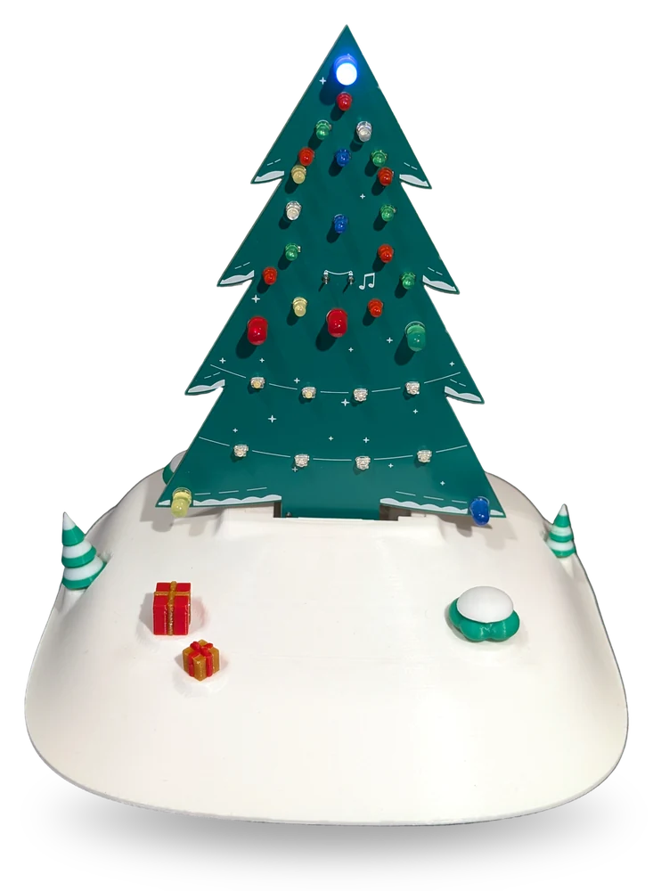

<a href="https://www.youtube.com/shorts/s0iBclSiKpc">▶ Video: der Baum spielt „In der Halle des Bergkönigs“</a>

## Ein Baum, fünf Hefte

Hat dich ein Heft hierher geschickt? Hier geht es zu seiner Seite.

<a class="heft" href="schlafender-baum/">
  
  
    Der schlafende Baum
    Python, Band 1
    Vierundzwanzig Türchen, jeden Tag eine kleine Aufgabe in Python. Wer sie löst, weckt den Baum.
  
</a>
<a class="heft" href="wachender-baum/">
  
  
    Der wachende Baum
    Python, Band 2
    In der Himmelswerkstatt sind 24 Seiten eines Buchs unleserlich geworden. Du schreibst sie neu, und der Baum lernt daraus Kunststücke.
  
</a>
<a class="heft" href="strahlender-baum/">
  
  
    Der strahlende Baum
    Python, Band 3
    Im dritten Band schreibst du die Pläne, nach denen in der Himmelswerkstatt Bäume entstehen.
  
</a>
<a class="heft" href="singender-baum/">
  
  
    Der singende Baum
    Malen und Singen · kommt noch
    Ein Malheft mit 24 leeren Seiten. Jeden Tag singt der Baum ein anderes Weihnachtslied, und dazu entsteht ein Bild.
  
</a>
<a class="heft" href="eingeschneit/">
  
  
    Eingeschneit auf der Hohen Wand
    Rätsel, mit Bleistift
    Neun Leute sitzen oben am Berg im Schnee fest, und jeden Tag fehlt etwas. Mit Plan, Aussagen und Bleistift findest du heraus, wer es hat.
  
</a>

## Welches Heft ist eingestellt?

Gleich nach dem Einstecken zeigt der Baum 3 Sekunden lang, zu welchem Heft er gerade gehört. Alles ist aus, auch der
Stern. Nur die zwei Lichterketten leuchten ruhig, dazu drei einzelne Lichter, bei jedem Heft andere. Danach ist er
2 Sekunden dunkel.

<figure>
  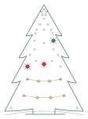
  <figcaption><b>Der schlafende Baum</b> Schalter 1 · <code>10000000</code></figcaption>
</figure>
<figure>
  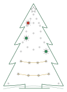
  <figcaption><b>Der wachende Baum</b> Schalter 2 · <code>01000000</code></figcaption>
</figure>
<figure>
  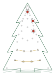
  <figcaption><b>Der strahlende Baum</b> Schalter 3 · <code>00100000</code></figcaption>
</figure>
<figure>
  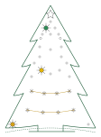
  <figcaption><b>Eingeschneit auf der Hohen Wand</b> Schalter 4 · <code>00010000</code></figcaption>
</figure>
<figure>
  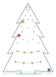
  <figcaption><b>Der singende Baum</b> Schalter 5 · <code>00001000</code></figcaption>
</figure>

## Das Heft wechseln

1. Den Stecker ziehen.
2. Beide Knöpfe gedrückt halten und den Stecker wieder einstecken. Sobald die zwei Lichterketten abwechselnd blinken,
   loslassen: Der Baum ist im **Wahlmodus**.
3. Den Code des Hefts an den Schaltern einstellen, er steht oben unter seinem Startbild, und **Bestätigen** drücken.
   Der Baum startet neu, zeigt das Startbild des Hefts und dann, wie weit er darin ist.

Jedes Heft behält seinen eigenen Stand. Kennt der Baum einen Code nicht, blinkt der Stern dreimal rot, dazu ein tiefer
Ton, und er bleibt im Wahlmodus. Wer ohne Wahl hinaus will, zieht den Stecker; geändert ist dann nichts.

## Was für alle Hefte gilt

- **Strom:** Der Baum läuft an jedem USB-Netzteil und an jedem Rechner, mit dem Kabel in der USB-C-Buchse hinten im
  Hügel. Wie weit er ist, merkt er sich auch ohne Strom. Die kleine Buchse unten am Stamm bleibt frei, sie ist nur
  zum Aufspielen seines Programms.
- **Ein Code:** Hinten sitzen acht Schalter und zwei Knöpfe. Schalter 1 ist die erste Ziffer, **ON** heißt 1. Dann
  **Bestätigen** drücken. Ein Code gilt auch, wenn du ihn von der anderen Seite her liest.
- **Musik:** Der Knopf mit der Note spielt, was der Baum schon kann. Beide Knöpfe kurz zusammen machen ihn lauter,
  beim dritten Mal wieder leise.
- **Wenn er etwas sagt:** Blinkt der Stern dreimal rot und brummt tief, passt der Code nicht. Blinkt er beim
  Einstecken rot und blau, stimmt etwas mit den Lichtern nicht: Stecker einmal ziehen und wieder einstecken.

Alles Weitere steht hinten in jedem Heft unter **Technik und Bedienung**.

## Ein eigenes Heft

In der [Baum-Werkstatt](werkstatt/) machst du selbst ein Heft für den Baum: was er an jedem der 24 Tage zeigt, welche
Lichter, welche Lieder. Die Werkstatt läuft im Browser, ohne Konto, und dein Heft bleibt als Datei auf deinem Rechner.
Die Codes der Tage würfelt sie, dein Heft bekommt ein eigenes Startbild samt Code für den Wahlmodus, und für das
gedruckte Heft gibt es Vorlagen für Word und LibreOffice.

- **Auf den Baum** kommt dein Heft aus Chrome oder Edge: den Baum aus dem Hügel nehmen, die Note halten und das Kabel
  vom Rechner in die kleine Buchse unten am Stamm stecken. In anderen Browsern kannst du dein Heft bearbeiten und
  speichern, aber nicht aufspielen.
- **Einstellen** wie jedes Heft im Wahlmodus, mit dem Code unter deinem Startbild.

<!-- FLYER: ERZEUGT von basis/flyer/auf_die_seite.py im Repo pytree – dort ändern und neu bauen. -->

## Flyer zum Weitergeben

Je Heft ein Flyer, dazu einer für den Baum mit allen Heften und einer für die Baum-Werkstatt: jeweils eine
Seite A4, zum Verschicken oder Ausdrucken.

<a class="flyer-karte" href="flyer/pytree.pdf" download="flyer-pytree.pdf">
  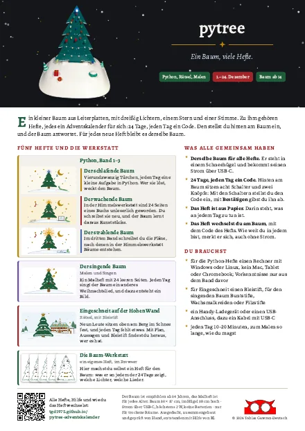
  Der Baum und alle Hefte
  PDF · eine Seite A4
</a>
<a class="flyer-karte" href="flyer/schlafender-baum.pdf" download="flyer-schlafender-baum.pdf">
  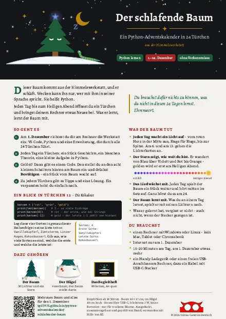
  Der schlafende Baum
  PDF · eine Seite A4
</a>
<a class="flyer-karte" href="flyer/wachender-baum.pdf" download="flyer-wachender-baum.pdf">
  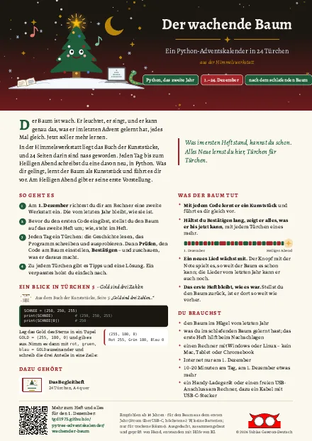
  Der wachende Baum
  PDF · eine Seite A4
</a>
<a class="flyer-karte" href="flyer/strahlender-baum.pdf" download="flyer-strahlender-baum.pdf">
  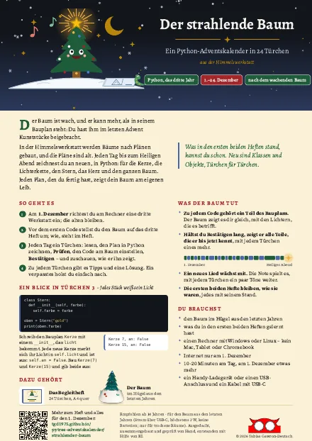
  Der strahlende Baum
  PDF · eine Seite A4
</a>
<a class="flyer-karte" href="flyer/singender-baum.pdf" download="flyer-singender-baum.pdf">
  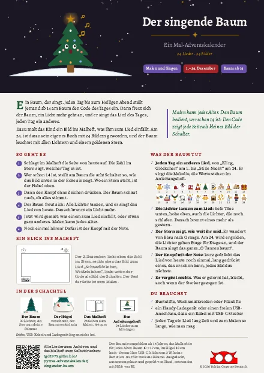
  Der singende Baum
  PDF · eine Seite A4
</a>
<a class="flyer-karte" href="flyer/eingeschneit.pdf" download="flyer-eingeschneit.pdf">
  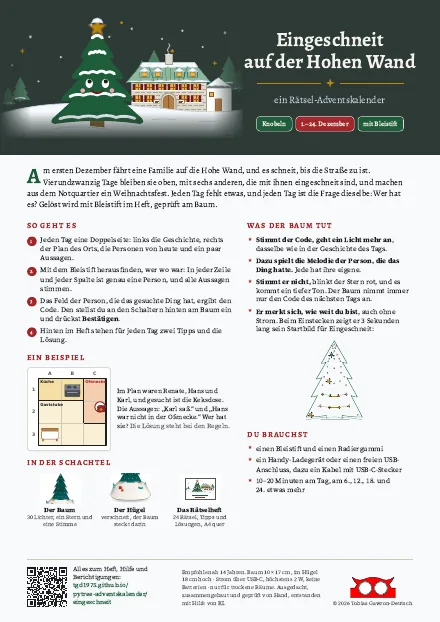
  Eingeschneit auf der Hohen Wand
  PDF · eine Seite A4
</a>
<a class="flyer-karte" href="flyer/baum-werkstatt.pdf" download="flyer-baum-werkstatt.pdf">
  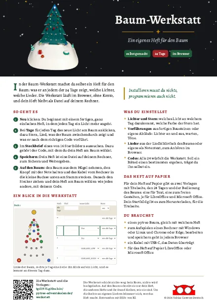
  Die Baum-Werkstatt
  PDF · eine Seite A4
</a>

<!-- /FLYER -->

## Hilfe

Häufige Fragen stehen auf der Seite des Hefts. Klemmt etwas, ist etwas unklar oder hast du eine Idee, schreib auf
GitHub ein [Issue](https://github.com/tgd1975/pytree-adventskalender/issues/new/choose), so heißen dort die Meldungen.
