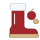
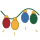
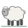

<!-- ERZEUGT von spiele/singend/werkzeug/baue_seite.py im Repo pytree – nicht von Hand ändern, dort ändern und neu bauen. -->
# Der singende Baum

*Ein Mal-Adventskalender.*

Ein Malheft mit 24 leeren Seiten, eine für jeden Tag. Jeder Tag hat einen Code. Stellt ihn jemand ab 14 am Baum ein,
geht ein Licht mehr an, und der Baum singt das Lied des Tages, jeden Tag ein anderes. Was das Kind dazu malt,
entscheidet es. Am 24. ist aus dem Heft ein eigenes Buch mit 24 Bildern geworden.

Malen kann jedes Alter. Den Baum bedient, wer schon 14 ist.

## So geht's

1. Schlagt im Malheft die Seite von heute auf. Die Zahl im Stern sagt, welcher Tag es ist.
2. Wer schon 14 ist, stellt am Baum die acht Schalter so, wie das Bild unten in der Ecke sie zeigt. Wo ein Stern steht, ist der Hebel oben.
3. Dann den Knopf ohne Zeichen drücken. Der Baum schaut nach, ob alles stimmt.
4. Der Baum freut sich: Alle Lichter tanzen, und er singt das Lied von heute. Danach brennt ein Licht mehr.
5. Jetzt wird gemalt: was einem zum Lied einfällt, oder etwas ganz anderes. Malen kann jedes Alter.
6. Noch einmal hören? Dafür ist der Knopf mit der Note.

Stimmen die Schalter, piept der Baum, und das neue Licht blinkt dreimal. Dann tanzen alle Lichter, und er singt das Lied von heute. Danach brennt ein Licht mehr als gestern, und der Stern wandert ein Stück von Blau nach Orange. Stimmen sie nicht, blinkt der Stern dreimal rot; dann die Schalter noch einmal einstellen. Ist ein Tag ausgelassen, will der Baum zuerst dessen Code: Die Tage kommen der Reihe nach. Kennt er den Code schon, zwinkert das neueste Licht zweimal. Am 24. gehen die Lichter Etage für Etage an, der Stern wird golden, und der Baum singt das ganze „O Tannenbaum“. „Stille Nacht“ singt er mit dem Knopf mit der Note.

## Die 24 Tage

Zu jedem Tag der Baum, wie er dann leuchtet, das Lied zum Anhören und eine Idee zum Malen.

  <picture class="tag-baum"><source srcset="tage/01_dunkel.svg" media="(prefers-color-scheme: dark)"></picture>
  

    
    1
    Kling, Glöckchen, klingelingeling
    <audio controls preload="none" src="hoeren/01.mp3"></audio>
    Vielleicht malst du heute, wer bei dir an der Tür läutet.
  

  <picture class="tag-baum"><source srcset="tage/02_dunkel.svg" media="(prefers-color-scheme: dark)"></picture>
  

    
    2
    Schneeflöckchen, Weißröckchen
    <audio controls preload="none" src="hoeren/02.mp3"></audio>
    Vielleicht malst du heute, wo die Flocken landen.
  

  <picture class="tag-baum"><source srcset="tage/03_dunkel.svg" media="(prefers-color-scheme: dark)"></picture>
  

    
    3
    A, a, a, der Winter, der ist da
    <audio controls preload="none" src="hoeren/03.mp3"></audio>
    Vielleicht malst du heute, was du im Schnee am liebsten machst.
  

  <picture class="tag-baum"><source srcset="tage/04_dunkel.svg" media="(prefers-color-scheme: dark)"></picture>
  

    
    4
    Leise rieselt der Schnee
    <audio controls preload="none" src="hoeren/04.mp3"></audio>
    Vielleicht malst du heute einen Schneemann, wie es noch keinen gab.
  

  <picture class="tag-baum"><source srcset="tage/05_dunkel.svg" media="(prefers-color-scheme: dark)"></picture>
  

    
    5
    Lasst uns froh und munter sein
    <audio controls preload="none" src="hoeren/05.mp3"></audio>
    Vielleicht malst du heute deinen Stiefel, blank geputzt vor der Tür.
  

  <picture class="tag-baum"><source srcset="tage/06_dunkel.svg" media="(prefers-color-scheme: dark)"></picture>
  

    
    6
    Stiefel-Polka
    <audio controls preload="none" src="hoeren/06.mp3"></audio>
    Vielleicht malst du heute den Nikolaus, wie er durch den Schnee stapft.
  

  <picture class="tag-baum"><source srcset="tage/07_dunkel.svg" media="(prefers-color-scheme: dark)"></picture>
  

    
    7
    O Tannenbaum
    <audio controls preload="none" src="hoeren/07.mp3"></audio>
    Vielleicht malst du heute einen Tannenbaum im Wald.
  

  <picture class="tag-baum"><source srcset="tage/08_dunkel.svg" media="(prefers-color-scheme: dark)"></picture>
  

    
    8
    Morgen, Kinder, wird&#x27;s was geben
    <audio controls preload="none" src="hoeren/08.mp3"></audio>
    Vielleicht malst du heute deinen Wunschzettel.
  

  <picture class="tag-baum"><source srcset="tage/09_dunkel.svg" media="(prefers-color-scheme: dark)"></picture>
  

    
    9
    Backe, backe Kuchen
    <audio controls preload="none" src="hoeren/09.mp3"></audio>
    Vielleicht malst du heute die Kekse, die du am liebsten magst.
  

  <picture class="tag-baum"><source srcset="tage/10_dunkel.svg" media="(prefers-color-scheme: dark)"></picture>
  

    
    10
    Am Weihnachtsbaume die Lichter brennen
    <audio controls preload="none" src="hoeren/10.mp3"></audio>
    Vielleicht malst du heute Kerzen, die im Dunkeln leuchten.
  

  <picture class="tag-baum"><source srcset="tage/11_dunkel.svg" media="(prefers-color-scheme: dark)"></picture>
  

    
    11
    Jingle Bells
    <audio controls preload="none" src="hoeren/11.mp3"></audio>
    Vielleicht malst du heute eine Fahrt mit dem Schlitten.
  

  <picture class="tag-baum"><source srcset="tage/12_dunkel.svg" media="(prefers-color-scheme: dark)"></picture>
  

    
    12
    Morgen kommt der Weihnachtsmann
    <audio controls preload="none" src="hoeren/12.mp3"></audio>
    Vielleicht malst du heute ein Geschenk, das du jemandem machen willst.
  

  <picture class="tag-baum"><source srcset="tage/13_dunkel.svg" media="(prefers-color-scheme: dark)"></picture>
  

    
    13
    Fröhliche Weihnacht überall
    <audio controls preload="none" src="hoeren/13.mp3"></audio>
    Vielleicht malst du heute Lichter, so viele du willst.
  

  <picture class="tag-baum"><source srcset="tage/14_dunkel.svg" media="(prefers-color-scheme: dark)"></picture>
  

    
    14
    We Wish You a Merry Christmas
    <audio controls preload="none" src="hoeren/14.mp3"></audio>
    Vielleicht malst du heute einen Tisch voller guter Sachen.
  

  <picture class="tag-baum"><source srcset="tage/15_dunkel.svg" media="(prefers-color-scheme: dark)"></picture>
  

    
    15
    Deck the Halls
    <audio controls preload="none" src="hoeren/15.mp3"></audio>
    Vielleicht malst du heute, wie ihr euer Zimmer schmückt.
  

  <picture class="tag-baum"><source srcset="tage/16_dunkel.svg" media="(prefers-color-scheme: dark)"></picture>
  

    
    16
    Kommet, ihr Hirten
    <audio controls preload="none" src="hoeren/16.mp3"></audio>
    Vielleicht malst du heute Schafe auf der Weide.
  

  <picture class="tag-baum"><source srcset="tage/17_dunkel.svg" media="(prefers-color-scheme: dark)"></picture>
  

    
    17
    Joy to the World
    <audio controls preload="none" src="hoeren/17.mp3"></audio>
    Vielleicht malst du heute ein Fest im Schnee, bei dem sich alle freuen.
  

  <picture class="tag-baum"><source srcset="tage/18_dunkel.svg" media="(prefers-color-scheme: dark)"></picture>
  

    
    18
    Alle Jahre wieder
    <audio controls preload="none" src="hoeren/18.mp3"></audio>
    Vielleicht malst du heute das Christkind.
  

  <picture class="tag-baum"><source srcset="tage/19_dunkel.svg" media="(prefers-color-scheme: dark)"></picture>
  

    
    19
    O du fröhliche
    <audio controls preload="none" src="hoeren/19.mp3"></audio>
    Vielleicht malst du heute Glocken, die läuten.
  

  <picture class="tag-baum"><source srcset="tage/20_dunkel.svg" media="(prefers-color-scheme: dark)"></picture>
  

    
    20
    Ihr Kinderlein, kommet
    <audio controls preload="none" src="hoeren/20.mp3"></audio>
    Vielleicht malst du heute den Weg zum Stall.
  

  <picture class="tag-baum"><source srcset="tage/21_dunkel.svg" media="(prefers-color-scheme: dark)"></picture>
  

    
    21
    Weißt du, wie viel Sternlein stehen
    <audio controls preload="none" src="hoeren/21.mp3"></audio>
    Vielleicht malst du heute den Himmel voller Sterne.
  

  <picture class="tag-baum"><source srcset="tage/22_dunkel.svg" media="(prefers-color-scheme: dark)"></picture>
  

    
    22
    Vom Himmel hoch, da komm ich her
    <audio controls preload="none" src="hoeren/22.mp3"></audio>
    Vielleicht malst du heute einen Engel.
  

  <picture class="tag-baum"><source srcset="tage/23_dunkel.svg" media="(prefers-color-scheme: dark)"></picture>
  

    
    23
    Tanz der Zuckerfee
    <audio controls preload="none" src="hoeren/23.mp3"></audio>
    Vielleicht malst du heute, was in der Nacht lebendig wird.
  

  <picture class="tag-baum"><source srcset="tage/24_dunkel.svg" media="(prefers-color-scheme: dark)"></picture>
  

    
    24
    Stille Nacht
    <audio controls preload="none" src="hoeren/24.mp3"></audio>
    Vielleicht malst du heute, wie es bei euch am Heiligen Abend aussieht.
  

## Das Malheft zum Selbstdrucken

Für Geschwister, für das nächste Jahr oder wenn ein Blatt fehlt: dasselbe Malheft, je Tag eine Seite, einseitig auf
A4 quer, ohne die leeren Rückseiten. Die Codes stehen auf den Seiten der Tage.

[Malheft herunterladen (PDF, 28 Seiten)](malheft.pdf)

Wer im nächsten Jahr neu anfangen will: Bestätigen und den Knopf mit der Note zusammen 5 Sekunden halten. Drei Töne
von hoch nach tief, und der Baum steht wieder vor dem ersten Tag.

Zurück zu [allen Heften](../).
