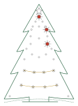

<!-- ERZEUGT von aufgaben/3_strahlend/werkzeug/baue_seite.py im Repo pytree – nicht von Hand ändern, dort ändern und neu bauen. -->
# Der strahlende Baum

*Band 3 des Python-Adventskalenders.*

Der Baum ist wach, und er kann mehr, als in seinem Bauplan steht: Du hast ihm im letzten Advent Kunststücke beigebracht.

In der Himmelswerkstatt werden Bäume nach Plänen gebaut, und die Pläne sind alt. Jeden Tag bis zum Heiligen Abend zeichnest du an neuen, in Python: für die Kerze, die Lichterkette, den Stern, das Herz und den ganzen Baum. Jeden Plan, den du fertig hast, zeigt dein Baum am eigenen Leib.

Was in den ersten beiden Heften stand, kannst du schon. Neu sind Klassen und Objekte, Türchen für Türchen.

**Vor dir steht der Baum, und das dritte Heft hat dich hierher geschickt? Dann bist du hier genau richtig.**

## Die Werkstatt einrichten

Die Installationsdateien für den strahlenden Baum kommen hier vor dem 1. Dezember dazu: eine für Windows, eine für Linux. Sie
holen VS Code, Python und die Erweiterung für dieses Heft in einen eigenen Ordner, Administratorrechte braucht es
dafür nicht. Die Werkstätten der letzten Jahre bleiben, wie sie sind.

## Den Baum auf das dritte Heft stellen

Noch steht der Baum auf dem zweiten Heft. Bevor du den ersten Code eingibst: Stecker ziehen, beide Knöpfe halten und
wieder einstecken, bis die Lichterketten abwechselnd blinken. Schalter auf `00100000`, **Bestätigen**. Jedes Heft
behält dabei seinen eigenen Stand. So sieht der Baum aus, wenn er auf dem dritten Heft steht:

## Wenn etwas klemmt

Klemmt etwas, ist etwas unklar oder hast du eine Idee, schreib auf GitHub ein
[Issue](https://github.com/tgd1975/pytree-adventskalender/issues/new/choose), so heißen dort die Meldungen.
