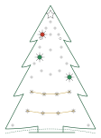
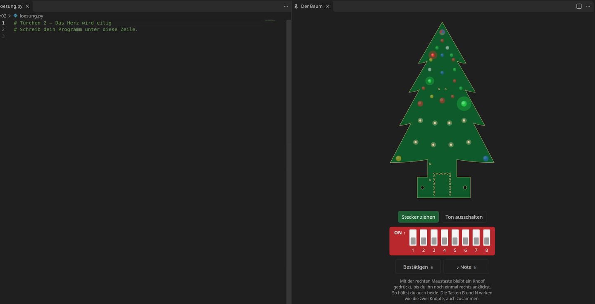

<!-- ERZEUGT von aufgaben/werkzeug/baue_seite.py --heft 2_wachend im Repo pytree – nicht von Hand ändern, dort ändern und neu bauen. -->
# Der wachende Baum

*Band 2 des Python-Adventskalenders.*

Der Baum ist wach. Er leuchtet, er singt, und er kann genau das, was er im letzten Advent gelernt hat, jedes Mal gleich. Jetzt soll er mehr lernen.

In der Himmelswerkstatt liegt das Buch der Kunststücke, und 24 Seiten darin sind nass geworden. Jeden Tag bis zum Heiligen Abend schreibst du eine davon neu, in Python. Was dir gelingt, lernt der Baum als Kunststück und führt es dir vor. Am Heiligen Abend gibt er seine erste Vorstellung.

Was im ersten Heft stand, kannst du schon. Alles Neue lernst du hier, Türchen für Türchen.

**Vor dir steht der Baum, und das zweite Heft hat dich hierher geschickt? Dann bist du hier genau richtig.**

## Die Werkstatt einrichten

Am einfachsten geht es mit einer Installationsdatei. Sie holt VS Code, Python und die Erweiterung für dieses Heft in einen eigenen
Ordner. Administratorrechte braucht es dafür nicht, und die Werkstatt vom letzten Jahr bleibt, wie sie ist.

- **Windows:**
  [installieren-wachender-baum-windows.cmd](https://github.com/tgd1975/pytree-adventskalender/releases/latest/download/installieren-wachender-baum-windows.cmd)
  herunterladen und doppelklicken. Warnt Windows: **Weitere Informationen**, dann **Trotzdem ausführen**.
- **Linux:**
  [installieren-wachender-baum-ubuntu.sh](https://github.com/tgd1975/pytree-adventskalender/releases/latest/download/installieren-wachender-baum-ubuntu.sh)
  herunterladen, mit **Strg+Alt+T** ein Terminal öffnen, `bash Downloads/installieren-wachender-baum-ubuntu.sh` eintippen und
  **Enter** drücken.

Danach startest du VS Code mit dem Symbol **Der wachende Baum** auf dem Desktop. Wie es weitergeht, zeigt dir die
Erweiterung. Gibt es im Dezember eine neue Fassung, führst du die Installationsdatei einfach noch einmal aus. Deine
Lösungen und dein Fortschritt bleiben.

Von Hand geht es auch: Die Erweiterung `pytree-wachender-baum-….vsix` liegt unter
[Releases](https://github.com/tgd1975/pytree-adventskalender/releases) beim neuesten Release „Der wachende Baum“ bei den **Assets**, dazu braucht
es [VS Code](https://code.visualstudio.com/). Was die Installationsdateien genau tun, steht in ihren ersten Zeilen.

Läuft unter Windows und Linux.

## Den Baum auf das zweite Heft stellen

Ein Baum kann auf jedem Heft der Reihe stehen. Bevor du den ersten Code eingibst: Stecker ziehen, beide Knöpfe
halten und wieder einstecken, bis die Lichterketten abwechselnd blinken. Schalter auf `01000000`, **Bestätigen**.
Jedes Heft behält dabei seinen eigenen Stand. So sieht der Baum aus, wenn er auf dem zweiten Heft steht:

## Der Baum am Bildschirm

Ohne Baum geht es auch: Die Erweiterung gibt es in einer Fassung, die den Baum mitbringt. Er steht in VS Code neben
deinem Programm, mit denselben acht Schaltern und zwei Knöpfen wie der echte. Du stellst den Code des Tages mit der
Maus ein, drückst **Bestätigen**, und er antwortet mit Licht und Ton.

[pytree-wachender-baum-simulator.vsix](https://github.com/tgd1975/pytree-adventskalender/releases/latest/download/pytree-wachender-baum-simulator.vsix) herunterladen, dann in VS Code: **Erweiterungen → … → Aus VSIX installieren** (englisch
**Install from VSIX**). VS Code und Python müssen dafür schon da sein, selbst installiert oder mit einer
Installationsdatei von oben. Hast du die Erweiterung schon, ersetzt diese Fassung sie; deine Lösungen und dein
Fortschritt bleiben. Das Heft liegt als PDF darin, am Tor der Werkstatt öffnet es der Knopf **Das Heft lesen**. Eine
Installationsdatei holt immer die Fassung ohne Baum: Führst du später eine noch einmal aus, installierst du danach
diese Datei neu.

## Ein Blick in Türchen 5 – Gold sind drei Zahlen

So sieht ein Türchen aus: ein Beispiel aus „Was du heute lernst“, darunter der erste Auftrag und daneben, was dein Programm dann ausgibt.

<b>Aus dem Buch der Kunststücke, Seite 5:</b> „Gold sind drei Zahlen…“

<pre>SCHNEE = (250, 250, 255)&#10;print(SCHNEE)          # (250, 250, 255)&#10;print(SCHNEE[0])       # 250</pre>

Leg das Gold des Sterns in ein Tupel <code>GOLD = (255, 180, 0)</code> und gib es aus. Nimm es dann mit <code>rot, gruen, blau = GOLD</code> auseinander und schreib die drei Anteile in eine Zeile:
<pre class="aus">(255, 180, 0)&#10;Rot 255, Grün 180, Blau 0</pre>

## Zum Weitergeben

Der Flyer zeigt auf einer Seite A4, was der wachende Baum ist – zum Verschicken oder Ausdrucken.
Die Flyer der anderen Hefte stehen auf der [Startseite](../#flyer-zum-weitergeben).

<a class="flyer-karte" href="../flyer/wachender-baum.pdf?v=c14e3f2a" download="flyer-wachender-baum.pdf">
  
  Der wachende Baum
  PDF · eine Seite A4
</a>

## Wenn etwas klemmt

Klemmt etwas, ist etwas unklar oder hast du eine Idee, schreib auf GitHub ein
[Issue](https://github.com/tgd1975/pytree-adventskalender/issues/new/choose), so heißen dort die Meldungen.
